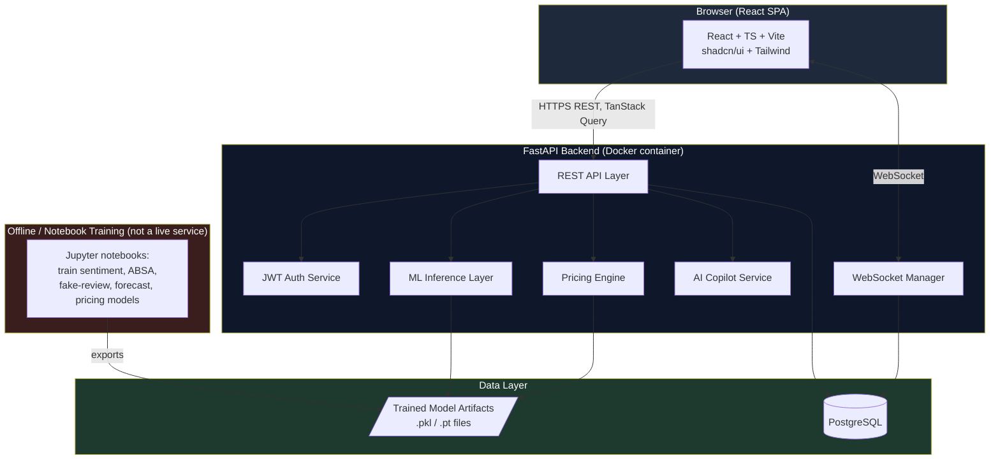
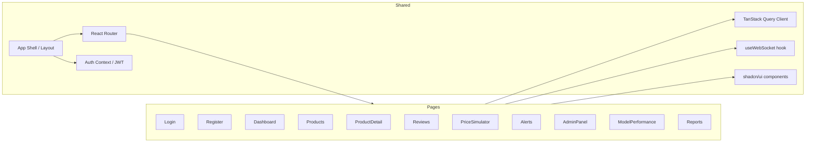
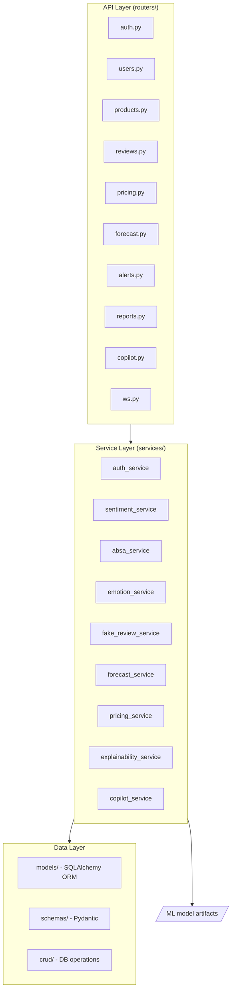
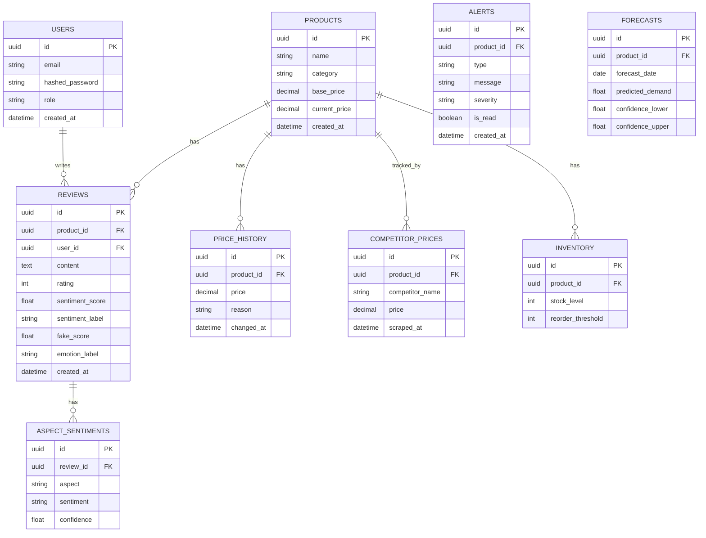
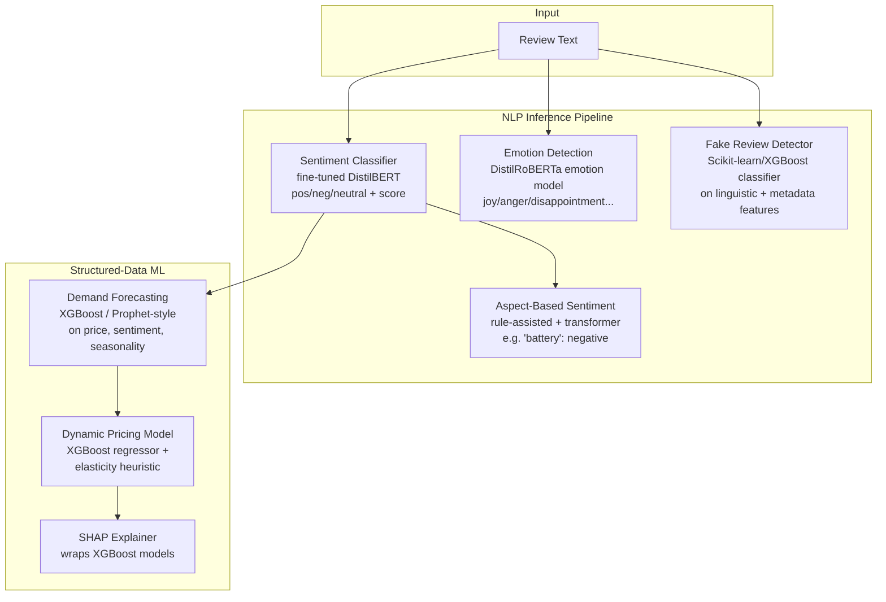
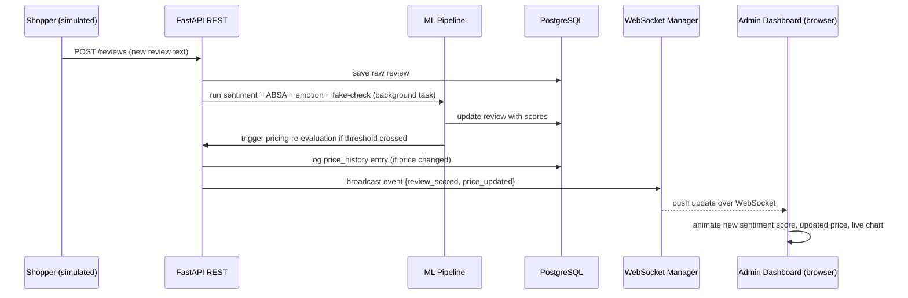
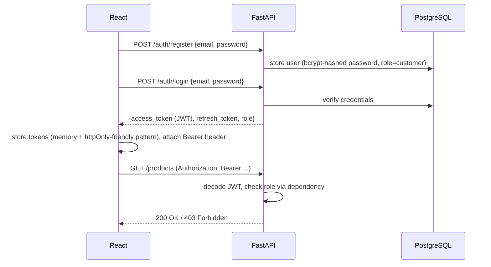

# SentiPrice AI — Architecture & Planning Document
### Real-Time Sentiment Analysis of Product Reviews for E-Commerce Dynamic Pricing

**Status:** Planning phase — no code written yet, per project scope.

---

## 0. Scoping Philosophy (read this first)

A final-year demo needs to be **impressive, working, and explainable in 10–15 minutes** — not production-grade at Amazon's scale. Every architectural decision below is filtered through three questions:

1. Can I explain this component to my professor in 2 sentences?
2. Does it run reliably on a MacBook with `docker compose up`?
3. Does it demonstrate a real ML/AI skill (not just CRUD)?

Where the feature list implies heavy infra (e.g., Redis, Kafka-style streaming, distributed training), I've scoped it down to the *smallest honest version* of that concept — real, working, but not over-engineered. I call these out explicitly so you know what's simplified and why, in case your professor asks.

---

## 1. Complete System Architecture



**Key decision: single FastAPI service, not microservices.** ML inference, pricing logic, and the copilot all live inside the same backend process as internal service modules (not separate deployed services). This is realistic for a project of this scope, avoids inter-service networking complexity, and is *still* clean architecture because we separate concerns by **module**, not by **container**. A microservices version would be strictly worse for you: harder to run, harder to debug live in front of a professor, and doesn't teach you anything extra for a B.Tech project.

**Redis — scoped down.** You listed it as "only if genuinely useful." Verdict: **skip it for MVP.** FastAPI's WebSocket manager can hold an in-memory connection registry for a single-process app, which is exactly what a demo needs. If you want to *mention* Redis in your report as a "production scaling path" (pub/sub across multiple workers), that's a legitimate one-paragraph discussion — but wiring it in for a single-instance demo adds a moving part that can break on stage for zero visible benefit. We can revisit this only if you specifically want to demonstrate horizontal scaling.

---

## 2. Frontend Architecture



**Structure principles:**
- **Feature-folder layout**, not type-folder layout (i.e., `features/pricing/`, not a giant flat `components/`).
- **TanStack Query** owns all server state (products, reviews, forecasts) — no Redux needed. This is a deliberate simplicity choice: state management libraries are overkill when Query + Context covers 100% of your needs.
- **React Hook Form + Zod** for every form (register, login, product create, CSV upload) — one validation pattern used consistently, easy to demo "type safety end-to-end."
- **Recharts** for all charts (sentiment trend, price elasticity curve, demand forecast, SHAP bar charts) — one charting library, not several.
- **Framer Motion** used sparingly: page transitions, alert toasts, live sentiment score updates pulsing in — enough to look polished, not a distraction.
- **WebSocket hook** (`useWebSocket`) centralizes the live connection (new review comes in → sentiment score animates in → price recommendation updates) — this is your best "wow" moment in the demo.

---

## 3. Backend Architecture



**Layering rule:** Routers only handle HTTP concerns (validation via Pydantic, status codes, auth dependency injection). All logic lives in `services/`. All DB access lives in `crud/`. This is the single most important thing that will make your codebase look "real" rather than "tutorial" — and it's genuinely the standard FastAPI pattern, not extra complexity for its own sake.

**Background/async work:** review-triggered sentiment inference and price recalculation run as `async` FastAPI background tasks (`BackgroundTasks`), not a separate task queue (no Celery). Celery + Redis + broker is overkill for a demo — background tasks give you the "processing happens, then a WebSocket push updates the UI" effect with a fraction of the infrastructure.

---

## 4. Database Architecture



**PostgreSQL, not SQLite.** You explicitly want PostgreSQL and it's the right call: real concurrent connections, real migrations story via Alembic, and JSON columns if you need to store SHAP explanation payloads flexibly.

**Migrations:** Alembic from day one. First migration = full schema. Every schema change afterward = new migration file. This alone is a good thing to show a professor — "here's my migration history," not "I dropped and recreated my DB every time."

**Competitor pricing — scoped down.** Real-time competitor scraping (e.g., live Amazon/Flipkart scraping) is legally grey and unreliable for a live demo (rate limits, layout changes, IP blocks). Instead: a `COMPETITOR_PRICES` table seeded with realistic synthetic/CSV data ("simulated competitor feed"), refreshed on a schedule or via CSV import. This is honest, demoable, and you can clearly state in your report that "in production this would integrate with a scraping/price-feed API"; the pricing algorithm itself doesn't care where the number came from.

---

## 5. ML Architecture



**Model choices (realistic, not maximal):**

| Task | Model | Why |
|---|---|---|
| Sentiment analysis | Pretrained DistilBERT sentiment model (Hugging Face, e.g. `distilbert-base-uncased-finetuned-sst-2-english`), optionally fine-tuned on a review dataset (Amazon Reviews / Flipkart reviews CSV) | Fast enough for real-time on CPU, genuinely good accuracy, easy to justify vs. training a transformer from scratch (unrealistic for a semester project) |
| Aspect-based sentiment | Hybrid: spaCy/keyword-based aspect extraction (battery, delivery, price, quality...) + sentiment classifier per extracted sentence/clause | Full ABSA transformer training is a research-level task; hybrid approach is standard practice and fully explainable in a viva |
| Emotion detection | Pretrained emotion classifier (e.g. `j-hartmann/emotion-english-distilroberta-base`) | Off-the-shelf, no training needed, adds a distinct "AI" data point beyond plain sentiment |
| Fake review detection | Scikit-learn/XGBoost classifier on engineered features: review length, rating-text mismatch, burstiness (many reviews same day), reviewer history, generic-language score | This is the *correct* way to do this on a real project — not another giant transformer. Trained on a labeled fake-review dataset (Kaggle has several) or a semi-synthetic labeled set you construct |
| Demand forecasting | XGBoost regression (or lightweight time-series baseline) using price, sentiment trend, seasonality features, on historical/simulated sales data | Interpretable, fast to train, SHAP-compatible |
| Dynamic pricing | XGBoost regressor for "optimal price" + an explicit elasticity/business-rule layer on top (min/max bounds, competitor floor/ceiling) | Pure black-box pricing is a bad idea and a worse demo. Showing "model suggests X, business rules clamp it to Y, here's why" is more credible and more explainable |
| Explainability | SHAP `TreeExplainer` on the XGBoost pricing/forecast models | XGBoost + SHAP is the best-supported, fastest combination — avoids slow/unstable SHAP on deep models |

**Where PyTorch fits:** the Hugging Face transformer models (sentiment, emotion) run on PyTorch under the hood via `transformers`. You are not writing custom PyTorch training loops for this project — that would be disproportionate effort for value in a full-stack demo. If your professor wants to see "real ML work," the fake-review detector and pricing/forecast models (trained by you, in a notebook, with a report on features/metrics/SHAP) are where you show that.

**Training happens offline, in notebooks**, producing serialized artifacts (`.pkl` for sklearn/XGBoost, cached HF model for transformers) that the FastAPI service loads at startup. The backend never trains models live — it only does inference. This is both realistic (how ML is deployed in practice) and demo-safe (no risk of a training job hanging during your presentation).

---

## 6. Real-Time Architecture



**In-memory connection manager** (a Python class holding a set of active `WebSocket` objects, keyed by user/room) is enough for one backend process. Events broadcast: `new_review_scored`, `price_changed`, `alert_created`, `forecast_updated`. This is a real, working WebSocket system — just without a message broker, because a message broker only earns its keep across multiple backend instances, which this project doesn't need.

---

## 7. Authentication Architecture



- **Password hashing:** `passlib[bcrypt]`.
- **JWT:** short-lived access token (~30 min) + refresh token flow (~7 days), via `python-jose`.
- **Roles:** `admin`, `analyst` (can see pricing/model dashboards), `customer` (writes reviews only). Enforced via a FastAPI dependency (`require_role("admin")`) reused across routers — one mechanism, applied everywhere, easy to explain.
- **Frontend:** `AuthContext` + Axios/fetch interceptor attaches the token; protected routes wrapped in a `RequireAuth` / `RequireRole` component.

---

## 8. API Architecture (representative surface)

| Group | Endpoints (representative) |
|---|---|
| Auth | `POST /auth/register`, `POST /auth/login`, `POST /auth/refresh`, `GET /auth/me` |
| Users/Admin | `GET /users`, `PATCH /users/{id}/role` |
| Products | `GET/POST /products`, `GET/PATCH/DELETE /products/{id}`, `POST /products/import` (CSV), `GET /products/{id}/export` |
| Reviews | `GET/POST /products/{id}/reviews`, `GET /reviews/{id}`, `GET /reviews/{id}/aspects` |
| Sentiment | `GET /products/{id}/sentiment-summary`, `GET /products/{id}/sentiment-trend` |
| Pricing | `GET /products/{id}/price-recommendation`, `POST /pricing/simulate`, `GET /products/{id}/price-history` |
| Forecasting | `GET /products/{id}/forecast` |
| Explainability | `GET /pricing/{id}/explanation` (SHAP values as JSON → rendered as bar chart) |
| Alerts | `GET /alerts`, `PATCH /alerts/{id}/read` |
| Reports | `GET /reports/summary`, `GET /reports/export` |
| Copilot | `POST /copilot/ask` |
| Model performance | `GET /models/metrics` |
| WebSocket | `WS /ws/live` |

All request/response contracts defined as Pydantic schemas → auto-generated OpenAPI docs at `/docs`, which itself is a good demo artifact ("here's my fully documented API").

---

## 9. Complete Folder Structure

```
sentiprice-ai/
├── docker-compose.yml
├── .env.example
├── README.md
│
├── backend/
│   ├── Dockerfile
│   ├── requirements.txt
│   ├── alembic.ini
│   ├── alembic/
│   │   └── versions/
│   ├── app/
│   │   ├── main.py
│   │   ├── core/
│   │   │   ├── config.py
│   │   │   ├── security.py
│   │   │   └── deps.py
│   │   ├── models/                # SQLAlchemy ORM models
│   │   ├── schemas/                # Pydantic schemas
│   │   ├── crud/                   # DB access layer
│   │   ├── routers/                # API endpoints
│   │   ├── services/
│   │   │   ├── sentiment_service.py
│   │   │   ├── absa_service.py
│   │   │   ├── emotion_service.py
│   │   │   ├── fake_review_service.py
│   │   │   ├── forecast_service.py
│   │   │   ├── pricing_service.py
│   │   │   ├── explainability_service.py
│   │   │   └── copilot_service.py
│   │   ├── ws/
│   │   │   └── manager.py
│   │   └── db/
│   │       └── session.py
│   └── tests/
│       ├── test_auth.py
│       ├── test_products.py
│       ├── test_reviews.py
│       └── test_pricing.py
│
├── ml/
│   ├── notebooks/
│   │   ├── 01_sentiment_finetune.ipynb
│   │   ├── 02_fake_review_detector.ipynb
│   │   ├── 03_demand_forecast.ipynb
│   │   ├── 04_dynamic_pricing_model.ipynb
│   │   └── 05_shap_explainability.ipynb
│   ├── data/                       # raw + processed datasets (gitignored if large)
│   ├── artifacts/                  # exported .pkl / model folders (loaded by backend)
│   └── src/                        # shared feature-engineering code, imported by notebooks
│
├── frontend/
│   ├── Dockerfile
│   ├── package.json
│   ├── vite.config.ts
│   ├── tailwind.config.ts
│   ├── src/
│   │   ├── main.tsx
│   │   ├── App.tsx
│   │   ├── routes/
│   │   ├── features/
│   │   │   ├── auth/
│   │   │   ├── products/
│   │   │   ├── reviews/
│   │   │   ├── pricing/
│   │   │   ├── forecasting/
│   │   │   ├── alerts/
│   │   │   ├── admin/
│   │   │   └── copilot/
│   │   ├── components/ui/          # shadcn components
│   │   ├── hooks/
│   │   │   └── useWebSocket.ts
│   │   ├── lib/
│   │   │   ├── api.ts               # axios instance + interceptors
│   │   │   └── auth-context.tsx
│   │   └── types/
│   └── tests/
│
└── docs/
    ├── architecture.md              # this document, refined over time
    ├── api-reference.md
    ├── demo-script.md
    └── report/                      # final B.Tech report material
```

---

## 10. Development Phases

```mermaid
gantt
    dateFormat  X
    axisFormat %s
    title Suggested Build Order (relative units, not calendar-fixed)

    section Foundations
    Repo scaffold, Docker Compose, DB, Alembic     :a1, 0, 2
    Auth (register/login/JWT/roles)                :a2, after a1, 2

    section Core CRUD
    Product mgmt + CSV import/export               :b1, after a2, 2
    Review submission + listing                    :b2, after b1, 1

    section ML Core
    Sentiment + emotion + ABSA inference service    :c1, after b2, 3
    Fake review detector (train + serve)            :c2, after c1, 2

    section Pricing Intelligence
    Forecasting model + service                     :d1, after c2, 2
    Pricing engine + SHAP explainability             :d2, after d1, 3
    Price simulator UI                               :d3, after d2, 1

    section Real-Time + Polish
    WebSockets + live dashboard                      :e1, after d3, 2
    Alerts engine                                     :e2, after e1, 1
    AI Copilot (LLM-assisted Q&A over your own data)  :e3, after e2, 2

    section Wrap-up
    Admin + model performance dashboards              :f1, after e3, 2
    Tests, Docker polish, docs, demo script           :f2, after f1, 2
```



**Recommended actual order (phases you'll confirm one at a time before I write code):**

1. **Phase 0 — Scaffold**: repo structure, Docker Compose (Postgres + backend + frontend), `.env`, base FastAPI app with health check, base Vite+React app that talks to it.
2. **Phase 1 — Auth**: register/login/JWT/roles, protected routes on both ends.
3. **Phase 2 — Core domain**: Products + Reviews CRUD, CSV import/export.
4. **Phase 3 — NLP pipeline**: sentiment, ABSA, emotion, fake-review detection wired into review submission.
5. **Phase 4 — Pricing intelligence**: forecasting, pricing engine, SHAP, price simulator, competitor/inventory data.
6. **Phase 5 — Real-time layer**: WebSockets, live dashboard updates, alerts.
7. **Phase 6 — AI Copilot**: a scoped assistant that answers questions like *"why did price for Product X increase?"* by querying your own DB + SHAP explanations (not a general chatbot — grounded in your data, which is far more impressive and far more explainable).
8. **Phase 7 — Admin/Model dashboards, reports, tests, Docker hardening, docs, demo rehearsal.**

Each phase = a working, demoable slice. You'll never be in a state of "half the app is broken" going into a review.

---

## 11. Dependencies

**Backend (`requirements.txt`, representative):**
```
fastapi
uvicorn[standard]
sqlalchemy
alembic
psycopg2-binary
pydantic
pydantic-settings
python-jose[cryptography]
passlib[bcrypt]
python-multipart
websockets
pandas
numpy
scikit-learn
xgboost
shap
transformers
torch          # CPU build
sentencepiece
pytest
httpx
```

**Frontend (`package.json`, representative):**
```
react, react-dom, react-router-dom
typescript, vite, @vitejs/plugin-react
tailwindcss, postcss, autoprefixer
shadcn/ui (generated components, not an npm dep per se — via CLI)
framer-motion
recharts
lucide-react
@tanstack/react-query
react-hook-form
zod, @hookform/resolvers
axios
```

**Infra:**
```
docker, docker compose
postgres:16 image
```

**No Redis, no Celery, no Kafka** in the base build — noted above, revisit only on request.

---

## 12. Potential Technical Risks

| Risk | Impact | Mitigation |
|---|---|---|
| `torch` + `transformers` model downloads are large/slow, and `torch` on Apple Silicon needs the right wheel | Build breaks or is huge | Pin CPU-only `torch` wheel; download/cache HF models once into `ml/artifacts/` and mount as a volume, don't re-download on every container start |
| Live model inference on CPU is slow for "real-time" feel | Demo lag | Keep models small (DistilBERT-class, not full BERT/GPT-class); batch nothing live — single review inference is fast enough (<1s) on CPU |
| SHAP on deep models is slow/unstable | Broken explainability demo | Restrict SHAP to the XGBoost pricing/forecast models only (fast, well-supported `TreeExplainer`) — don't attempt SHAP on the transformers |
| Competitor price scraping breaks live (rate-limited/blocked) | Demo-day failure, ethically grey | Use simulated/CSV-seeded competitor data, clearly labeled as such in the report |
| WebSocket + auth interplay (token expiry mid-connection) | Silent disconnects | Pass JWT as a query param or first-message auth on WS connect; reconnect logic in `useWebSocket` |
| Docker Compose flakiness on first run (DB not ready when backend starts) | Container crash loop | `depends_on` + healthcheck on Postgres + startup retry loop in backend DB connection |
| Fake-review / demand datasets are hard to find pre-labeled | Weak model training story | Use a public Amazon/Flipkart review dataset for sentiment; construct a semi-synthetic labeled fake-review set (inject synthetic spam/duplicate reviews into a real dataset) — this is a standard, defensible academic technique, and you should document it as such |
| Scope creep — 20+ features listed | Nothing finishes cleanly | Strict phase gating (section 10); each phase must be demoable before starting the next |
| M-series Mac + `psycopg2-binary`/`torch` compatibility issues | Local install pain | Run everything inside Docker (linux/amd64 or arm64 images as appropriate) rather than relying on local Python env |

---

## 13. Keeping It Runnable on a MacBook

- **Single command startup:** `docker compose up --build` brings up Postgres, backend, frontend. No manual `brew install postgresql`, no local Python venv required for the demo machine.
- **Model artifacts pre-baked, not downloaded live:** HF models pulled once during development, saved into `ml/artifacts/`, and that folder is what ships/mounts into the backend container — no internet dependency during the actual demo (critical: don't rely on WiFi in the exam room).
- **Lightweight models only:** DistilBERT-class (~260MB) not BERT-large/GPT-class — keeps image size and RAM usage sane on a laptop (works fine on 8–16GB RAM).
- **Apple Silicon:** use `torch` CPU wheel; Docker Desktop on Mac handles arm64 images natively — just make sure base images (`python:3.11-slim`, `node:20-slim`) have arm64 variants (they do).
- **Data volume:** Postgres data as a named Docker volume, so restarting containers doesn't wipe your demo data; provide a `seed.py`/SQL seed script to repopulate from scratch in under a minute if needed.
- **No cloud dependency required for the demo** — Copilot feature is the one place an external LLM API *could* be tempting; we'll scope it to either (a) a local/rules+templates-assisted "copilot" that queries your own SHAP/forecast data and formats a natural-language answer, or (b) an optional real LLM call behind a feature flag with a graceful fallback if there's no internet/API key on demo day. You choose when we get there.

---

## 14. How the Final Demo Will Work

**Suggested 10–12 minute flow:**

1. **Open dashboard** (already seeded with ~5-10 products, ~100+ historical reviews) — show sentiment trend, price history chart, live "health" of the system.
2. **Live moment #1 — submit a new review** through the UI (or a small script) as a "customer" → watch, on screen, in real time via WebSocket: sentiment score appears, aspect breakdown appears, emotion tag appears, fake-review score appears, and (if it crosses a threshold) a price recommendation updates with a toast/alert.
3. **Explainability** — click into "why this price?" → SHAP bar chart shows feature contributions (sentiment trend, demand forecast, competitor price, inventory level) in plain language.
4. **Price Simulator** — professor picks a hypothetical: "what if sentiment drops 20%?" / "what if competitor cuts price 10%?" → simulator recalculates and shows the new recommendation live — this is a strong interactive moment for a viva.
5. **Admin & Model Performance dashboard** — accuracy/F1 of sentiment & fake-review models, feature importance, forecast error metrics — shows you understand evaluation, not just building.
6. **AI Copilot** — ask a natural question ("Which products are most at risk of a price drop this week?") and get a grounded answer referencing real data from the DB.
7. **Reports/export** — download a CSV/summary report for a product — shows the practical, business-facing side of the tool.
8. **Close** with architecture diagram (this doc) — 60 seconds on stack + design decisions (why XGBoost+SHAP, why DistilBERT, why no Redis) shows deliberate engineering judgment, which is exactly what professors reward over "I used every buzzword."

I'll also prepare a `docs/demo-script.md` with exact click-paths and fallback talking points (e.g., what to say if WiFi drops) once we're closer to that phase.

---

## Summary — What I need from you before we move to Phase 0

1. Confirm you're happy with the scoping calls above (no Redis/Celery/Kafka for MVP, competitor pricing simulated not scraped, transformers used pretrained/fine-tuned not trained from scratch, single-service backend not microservices).
2. Tell me whether you want to work **here** (I generate files, you download and drop into your real VS Code workspace) or whether you'll switch to **Claude Code** for direct local workspace access — either works, but it changes how I hand off files to you.
3. Confirm the phase order in Section 10, or tell me if you want to reorder/drop anything.

Once you confirm, I'll start Phase 0 (scaffold) — and only Phase 0, nothing more, until you review it.
